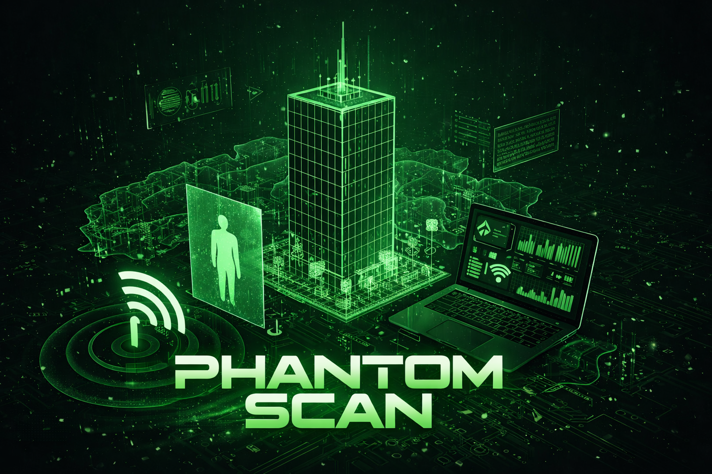

<p align="center">
  
</p>

<h1 align="center">Phantom Scan</h1>
<p align="center"><strong>Through-wall human presence sensing from two $7 ESP32-S3 radios — no cameras, no wearables.</strong></p>

<p align="center">
  <a href="https://nodejs.org/"></a>
  <a href="https://www.python.org/"></a>
  <a href="https://www.espressif.com/"></a>
  <a href="#recording--replay"></a>
  <a href="#testing"></a>
  <a href="https://opensource.org/licenses/MIT"></a>
</p>

Phantom Scan turns Wi-Fi Channel State Information (CSI) from two ESP32-S3 nodes into a live radar-style view of a room: a moving-target position, distance and approach/recede trend for each node, and board-side vital signs (breathing, heart rate) — rendered in a React dashboard fed by an Express/WebSocket host in real time.

**This is not** a drone, GPS/IMU, or MAVLink flight-control project. It targets a fixed, ground-based, two-node deployment, and it says so honestly where its physics run out (see [Honest Limitations](#honest-limitations)).

> | Focus | Current State |
> |---|---|
> | **Hardware** | Exactly **2** ESP32-S3 nodes |
> | **Live path** | Express + WebSocket + React, in one Node/TS process |
> | **Runtime authority** | `server/` (Node/TS) — see [ADR-051](docs/adr/ADR-051-runtime-authority.md) |
> | **Recording format** | JSONL only |
> | **Degraded behavior** | stays up on one node; fused output withheld until both are valid |
> | **Localization** | 1-D (along the N1–N2 line) by design — no false 2-D claims |
> | **Priority order** | correctness → observability → replayability → testing |

---

## Table of Contents

- [Quick Start](#quick-start)
- [Runtime Authority](#runtime-authority)
- [System Design](#system-design)
- [Phantom Balance Fusion](#phantom-balance-fusion)
- [Wire Protocol](#wire-protocol)
- [Environment Variables](#environment-variables)
- [Setup](#setup)
- [Usage](#usage)
- [Testing](#testing)
- [Recording & Replay](#recording--replay)
- [Project Structure](#project-structure)
- [Documentation Index](#documentation-index)
- [Honest Limitations](#honest-limitations)
- [License](#license)

---

## Quick Start

Pick the path that matches what you're doing right now.

### 1. Full stack (dashboard + Python reference runtime side by side)

```bash
npm install
npm run dev
```

### 2. Dashboard only (Node/TS live path — this is what talks to real hardware)

```bash
npm install
npm run dev:dashboard
```

Open [http://localhost:5000](http://localhost:5000) and log in ([default local credentials](#usage)). Point your ESP32-S3 nodes' UDP stream at this host on port `5005`.

### 3. Firmware — build, flash, provision

```bash
# Build (Docker is the only reliable method, especially on Windows)
MSYS_NO_PATHCONV=1 docker run --rm \
  -v "$(pwd)/firmware/esp32-csi-node:/project" -w /project \
  espressif/idf:v5.2 bash -c \
  "rm -rf build sdkconfig && idf.py set-target esp32s3 && idf.py build"

# Flash
python -m esptool --chip esp32s3 --port COM7 --baud 460800 \
  write_flash --flash_mode dio --flash_size 8MB \
  0x0 firmware/esp32-csi-node/build/bootloader/bootloader.bin \
  0x8000 firmware/esp32-csi-node/build/partition_table/partition-table.bin \
  0x10000 firmware/esp32-csi-node/build/esp32-csi-node.bin

# Provision Wi-Fi + target IP without reflashing
python esp-flash.py --port COM7 --ssid "YourSSID" --password "YourPass" --target-ip 192.168.1.20
```

See [firmware/esp32-csi-node/README.md](firmware/esp32-csi-node/README.md) for the full firmware architecture and Windows/Ubuntu setup notes in [docs/WINDOWS_ESP32_SETUP.md](docs/WINDOWS_ESP32_SETUP.md) / [docs/UBUNTU_ESP32_SETUP.md](docs/UBUNTU_ESP32_SETUP.md).

### 4. Python reference path (replay, offline DSP, tests only — not live)

```bash
python -m pytest tests/ -q
python -m phantom.runtime replay --input <session.jsonl>
```

---

## Runtime Authority

There are two runtime tracks in this repository, and only one of them is allowed to be live at a time.

> **The Node/TS server (`server/`) is the sole live authority.** It is the only process that may bind UDP `:5005`, and the only publisher of derived frames (WebSocket `/ws` on `:5000`). See [ADR-051](docs/adr/ADR-051-runtime-authority.md).

**Live dashboard path (`server/`)**
- `server/lib/udp-server.ts` binds UDP `:5005`, parses CSI + heartbeat + feature-state frames, and source-pins each node.
- `server/lib/websocket.ts` runs the DSP/fusion pipeline and publishes `radialTarget`, `targetState`, node beacon markers, and firmware metrics over `/ws`.
- Firmware DSP metrics (presence, motion, respiration, heart rate at 1 Hz/node) render in the **Board DSP** card, kept strictly separate from host-side fusion for cross-checking.
- Express handles auth/audit; accepted raw frames are optionally forwarded to an AI sidecar on `:5006`.

**Python reference path (`phantom/`)**
- `phantom.protocol`, `phantom.ingest`, `phantom.recording`, `phantom.dsp`, `phantom.runtime`, `phantom.api` remain the replay/recording/reference-DSP toolkit and the target for the Python test suite.
- Its live mode is retired: `python -m phantom.runtime live` refuses to bind by default, and will only start under the explicit compatibility override `PHANTOM_ALLOW_RETIRED_LIVE_AUTH=1` — which must never be set while the dashboard is running (both would fight over UDP `:5005`).

| Port | Owner | Purpose |
|---|---|---|
| `5000` (falls back to `5001`–`5019` if busy) | `server/` | Dashboard UI + API |
| `5005` | `server/` (sole owner) | ESP32 → host CSI/vitals/heartbeat ingest (UDP) |
| `5006` | `server/` → AI sidecar | Forwarded raw frames for optional ML inference |

---

## System Design

Phantom Scan is organized in five layers, firmware to browser:

```text
ESP32-S3 node 1 ----\
                     \        UDP :5005 ingest        targetState / metrics
ESP32-S3 node 2 -------> Node/TS host runtime ------------------------------> React dashboard
                            |          \
                            |           \-> JSONL session recording (data/sessions/)
                            |
                            \-> deterministic DSP -> Phantom Balance Fusion -> WebSocket /ws
```

**Replay path:**
```text
JSONL session -> parser -> runtime semantics -> deterministic DSP -> dashboard-compatible outputs
```

| Layer | Responsibility | Key files |
|---|---|---|
| **A — Firmware capture** | Capture CSI on-device, timestamp, self-ping the gateway (ICMP @ ~50 Hz) so the CSI engine doesn't starve on a quiet network, stream UDP frames | `firmware/esp32-csi-node/main/{main.c, csi_collector.c, stream_sender.c, nvs_config.c}` |
| **B — Host ingest** | Receive UDP, validate schema/version, preserve device + host timestamps, detect loss/reorder, maintain per-node state, write JSONL | `server/lib/{udp-server.ts, websocket.ts}`, `shared/schema.ts`; Python: `phantom/{protocol,ingest,recording,runtime}.py` |
| **C — Deterministic DSP** | Amplitude extraction, phase unwrap, static-clutter suppression, Hampel filter, respiration-band filtering, motion energy, cross-node correlation | `phantom/dsp.py`, `scripts/csi_filter_pipeline.py` |
| **D — Optional ML** | Disabled/isolated by default; system must keep running in DSP-only mode if models are absent | `scripts/ai_inference.py`, `ai model and densepose/` (model weights are a git submodule pointer, never committed directly) |
| **E — API / UI** | Operator login, audit logging, live dashboard rendering, history/report/activity views | `server/`, `client/` |

**Degraded-mode rules:** the system stays up when one node is missing; per-node ingest and DSP keep running; fused output is withheld unless both nodes are valid and time-aligned; the dashboard must never invent an active target when truthful state says there isn't one.

---

## Phantom Balance Fusion

When both nodes are live (`fused_two_node`), Phantom Scan places the target on the straight line between the two boards using the **cross-node motion ratio** — a deliberately honest 1-D model, not a fabricated 2-D position.

### Geometry

Node anchors are a single shared constant (`NODE_ANCHORS` in `shared/schema.ts`):

```text
N1 = (-1.5, 0)      N2 = (+1.5, 0)      separation = 3 m, origin at the midpoint
```

Coordinate conventions live in one place, `shared/bearing.ts` — never inline the trig elsewhere:
- **`theta`** — compass bearing, `atan2(x, z)`, 0° = north, clockwise-positive.
- **`angle`** — direction of travel, math convention, `atan2(vz, vx)`, 0° = east.

### How the fusion works (`server/lib/node-fusion.ts`)

1. Each node keeps a **`PHANTOM_MOTION_WINDOW_MS`** window (default **1500 ms**) of per-subcarrier amplitude frames (up to 64 subcarriers/packet). Motion energy is the temporal standard deviation of each subcarrier, averaged across subcarriers, giving a raw `absStd` per node.
2. **Display position** (`radialTarget.balance`) — `balance = r2^p / (r1^p + r2^p)` over the raw `absStd` values, where `p` is `PHANTOM_BALANCE_CONTRAST` (default **2.0**, widens the balance toward whichever node sees clearly more perturbation). The on-screen `x` further applies a nearest-node display bias, `PHANTOM_BALANCE_BIAS_EXPONENT` (default **0.72**).
3. **Authoritative cross-check** (`radialTarget.balanceLinear`) — the plain, undecorated `r2 / (r1 + r2)` ratio, independent of the contrast exponent and display bias. This is what an analytics or ground-truth consumer should read; it never drives what's drawn on screen. See [ADR-054](docs/adr/ADR-054-fusion-display-vs-authoritative-balance.md) for why display and authoritative values are intentionally different.
4. Target position: `x = N1.x + (N2.x − N1.x) · (biased balance)` — it slides along the N1–N2 axis.
5. **Empty-room gate:** no target is emitted (never a centered ghost) unless `max(motion1, motion2)` clears `PHANTOM_MOTION_THRESHOLD` (default **0.12** — a placeholder pending empty-room + fan/curtain calibration on real hardware).

Each broadcast node also carries `distanceM` (along-axis distance to the target) and `trend` (`approaching` / `receding` / `stable`, from the sign of `d(balance)/dt` with a `PHANTOM_TREND_DEADBAND_MPS` deadband, default 0.05 m/s). The radar renders two labeled beacons (N1 cyan, N2 pink), the N1–N2 axis line, connector lines to the target, and a travel arrow toward the node being approached.

---

## Wire Protocol

All packets travel over UDP to the host on `:5005`. A 4-byte little-endian magic number identifies the frame type.

| Magic | Frame | Rate | Notes |
|---|---|---|---|
| `0xC5110001` | CSI frame | ~41-43 pps/node measured (50 Hz firmware send-rate cap, not a guaranteed rate — see `csi_collector.c` `CSI_MIN_SEND_INTERVAL_US`) | 32-byte header (ADR-018); legacy 20-byte header accepted only under `PHANTOM_ALLOW_LEGACY_CSI` |
| `0xC5110002` | Vitals | 1 Hz/node | Board-side presence/motion/vitals, shown alongside — never fused into — the host-DSP target math |
| `0xC5110004` | WASM module output | event-driven | Output from optional programmable sensing modules |
| `0xC5110006` | Feature-state | 1 Hz/node | Board-computed motion/presence/respiration/heart-rate metrics for the **Board DSP** card |
| `0xC51100A1` | Heartbeat | periodic | Per-node liveness signal |

---

## Environment Variables

| Variable | Default | Purpose |
|---|---|---|
| `NODE_ENV` | — | `development` / `production` |
| `PORT` / `HOST` | `5000` / all interfaces | Dashboard HTTP/WebSocket bind |
| `UDP_PORT` | `5005` | CSI ingest bind port |
| `PHANTOM_MOTION_WINDOW_MS` | `1500` | Fusion motion-energy time window |
| `PHANTOM_MOTION_THRESHOLD` | `0.12` | Empty-room detection gate (calibration placeholder) |
| `PHANTOM_BALANCE_CONTRAST` | `2.0` | Display-balance contrast exponent |
| `PHANTOM_BALANCE_BIAS_EXPONENT` | `0.72` | Nearest-node display bias exponent |
| `PHANTOM_TREND_DEADBAND_MPS` | `0.05` | Approach/recede trend deadband |
| `PHANTOM_STATIC_NODE_SOURCES` | — | JSON mapping to pin node IDs to fixed source IPs |
| `PHANTOM_ROOM_GEOMETRY_ID` / `PHANTOM_WALL_CELL` / `PHANTOM_WALL_THICKNESS_M` | — | Room/wall geometry context for display |
| `PHANTOM_AUDIT_DIR` | — | Audit log output directory |
| `PHANTOM_FIRMWARE_BUILD_ID` / `PHANTOM_SELF_PING_STATUS` | — | Firmware build/status metadata surfaced in the UI |
| `PHANTOM_OPERATOR_SEED_PATH` | `data/operator.json` | Operator credential store |
| `PHANTOM_SESSION_SECRET` | — | Session signing secret |
| `PHANTOM_BOOTSTRAP_TOKEN` | — | Required for first-operator bootstrap from a non-loopback address |
| `PHANTOM_ALLOW_LEGACY_CSI` | unset (off) | Compatibility opt-in for legacy 20-byte CSI frames |
| `PHANTOM_ALLOW_RETIRED_LIVE_AUTH` | unset (off) | Required to start the retired Python live mode |
| `PHANTOM_AUTHORITY_HOST` / `PHANTOM_AUTHORITY_PORT` / `PHANTOM_AUTHORITY_URL` | `127.0.0.1` / `8789` | Address of the Python reference runtime when run alongside `npm run dev` |
| `DATABASE_URL` | — | Postgres connection string (`drizzle-kit push`, session store) |
| `PHANTOM_PYTHON` / `PYTHON` | — | Explicit Python interpreter path override |

---

## Setup

### 1. Node dashboard

Requirements: Node.js 18+, npm.

```bash
npm install
npm run check              # type-check
npm run dev:dashboard      # dashboard only
npm run dev                # dashboard + Python reference runtime together
npm run build && npm run start   # production
```

### 2. Python reference runtime

Requirements: Python 3.13.

```bash
python -m pytest tests/ -q
python -m phantom.runtime replay --input <session.jsonl>
```

### 3. Firmware

Requirements: Docker (recommended — `idf.py` directly on Windows is unreliable via MSYS2), ESP32-S3 hardware, serial access.

See [Quick Start §3](#quick-start) for the build/flash/provision commands, and [firmware/esp32-csi-node/README.md](firmware/esp32-csi-node/README.md) for the full architecture. On Windows, allow the UDP port through the firewall:

```bash
netsh advfirewall firewall add rule name="ESP32 CSI" dir=in action=allow protocol=UDP localport=5005
```

Platform-specific walkthroughs: [docs/WINDOWS_ESP32_SETUP.md](docs/WINDOWS_ESP32_SETUP.md), [docs/UBUNTU_ESP32_SETUP.md](docs/UBUNTU_ESP32_SETUP.md), [docs/LOCAL_DEPLOYMENT.md](docs/LOCAL_DEPLOYMENT.md).

---

## Usage

1. Start the dashboard: `npm run dev:dashboard` (or `npm run dev` for the full stack).
2. Open [http://localhost:5000](http://localhost:5000).
3. Log in — current local development seed is username `thaer` / password `thaer` (a dev convenience, not a production credential policy).
4. Start a scan and confirm both ESP32-S3 nodes are streaming UDP traffic to the host.

Dashboard surfaces:

| Component | What it shows |
|---|---|
| Radar / point cloud (`RadialScene.tsx`, `point-cloud-3d.tsx`) | Live target position on the N1–N2 axis, node beacons, distance/trend labels |
| AoA heatmap & spectrum | Angle-of-arrival energy per node |
| Vitals monitor | Breathing/heart-rate estimates |
| Node Features / Board DSP card | Firmware-computed metrics, shown independently for cross-checking |
| AI Advisory panel | Optional AI-sidecar output, clearly marked non-authoritative |
| Metrics / control panel | Live signal metrics and scan controls |
| History / Activity / Report pages | Past sessions, audit activity, generated reports |

---

## Testing

```bash
npm test                     # TypeScript: server/**/*.test.ts + tests/behavioral/**/*.test.ts
npm run test:dashboard-auth  # TypeScript: server tests only
npm run test:py              # Python: pytest tests/
```

Current verified state ([PHANTOM_SCAN_REMEDIATION_REPORT.md](PHANTOM_SCAN_REMEDIATION_REPORT.md)):

- **TypeScript:** `132 pass, 0 fail`
- **Python:** `81 passed, 6 skipped` (skips are environmental — a missing `torch` dependency and tests that require a running dev server on `:5000` — not regressions)
- **Firmware:** `firmware/esp32-csi-node/main/test/test_edge_dsp_pure.c` is host-compiled independently (`gcc -std=c99 -O2 -I. test/test_edge_dsp_pure.c edge_dsp_pure.c -lm -o test/test_edge_dsp_pure.exe`); not part of `npm test` or `pytest`.

---

## Recording & Replay

Recording format is **JSONL only**. A session is a sequence of typed records:

`session_header` → `csi_frame` / `heartbeat` → `derived_frame` → `session_footer`

- Both device and host receive timestamps are preserved (device timestamp is authoritative when valid; host timestamp is the audit/fallback).
- Replay runs through the exact same parser/runtime semantics as live mode.
- `data/sessions/_index.json` indexes every recorded session (id, name, start/end time, duration, frame count, target classification + confidence, average distance/speed, data source).

---

## Project Structure

```text
phantom scan/
├── client/                      React + Vite dashboard (Vite root: client/)
│   └── src/
│       ├── pages/                dashboard, login, activity, history, report
│       ├── components/dashboard/ radar scene, AoA views, vitals, AI advisory, node features
│       └── hooks/                use-websocket.ts, use-auth.tsx
├── server/                      Express host — the live runtime authority
│   ├── index.ts                  entrypoint: auth, websocket, routes, UDP server
│   ├── lib/                      udp-server.ts, websocket.ts, node-fusion.ts, target-state.ts, ...
│   └── auth/                     session/auth service
├── shared/                      Zod schemas shared by client + server (schema.ts, bearing.ts, ...)
├── phantom/                      Python reference runtime (replay, DSP, tests — not live)
├── firmware/esp32-csi-node/      ESP-IDF firmware project (own README, own build)
├── scripts/                      capture, replay, calibration, reporting utilities
├── script/                       dev orchestration (dev-full.cjs, build.ts)
├── tests/                        Python pytest suite + tests/behavioral/ (tsx --test)
├── data/                         sessions/ (JSONL + _index.json), operator store, audit/
└── docs/                         ADRs, deployment guides, technical reports
```

---

## Documentation Index

**Current / binding**

| Document | What it covers |
|---|---|
| [PHANTOM_SCAN_REMEDIATION_REPORT.md](PHANTOM_SCAN_REMEDIATION_REPORT.md) | Most up-to-date record of what's fixed, deferred, and still an open operator action |
| [ADR-051](docs/adr/ADR-051-runtime-authority.md) | Why the Node/TS server, not Python, owns live runtime |
| [ADR-054](docs/adr/ADR-054-fusion-display-vs-authoritative-balance.md) | Why `balance` (display) and `balanceLinear` (authoritative) intentionally differ |
| [RUN.md](RUN.md) | Canonical start sequence and port map |
| [docs/research/csi-phase-in-wifi-sensing.md](docs/research/csi-phase-in-wifi-sensing.md) | How CSI phase is used for AoA, ranging, and vital signs, and why raw phase needs SFO/PDD sanitization first |
| [BOOTSTRAP.md](BOOTSTRAP.md) | One-page command cheat sheet |
| [SETUP_AUDIT.md](SETUP_AUDIT.md) / [AUDIT.md](AUDIT.md) | Setup and repository disposition audits |

**Historical / archived** — kept for context, not descriptions of the current system:

| Document | Why it's historical |
|---|---|
| [docs/ruview-2node-full-analysis-report.md](docs/ruview-2node-full-analysis-report.md) | Explicitly archived; superseded by ADR-051 and this README |
| [docs/adr/README.md](docs/adr/README.md) (44-ADR catalog) | Documents a broader, more ambitious multistatic-mesh / pose-estimation vision than the two-node system actually shipped here — many entries are `Proposed` or `Superseded` |
| [TARGET_RENDER_AUDIT.md](TARGET_RENDER_AUDIT.md) | Marked superseded at the top; point-in-time record of fixed rendering bugs |
| [MILESTONE1_FIX_PLAN.md](MILESTONE1_FIX_PLAN.md), [TARGET_TEST_PLAN.md](TARGET_TEST_PLAN.md), [TARGET_VERIFICATION_REPORT.md](TARGET_VERIFICATION_REPORT.md) | Point-in-time stabilization/test records |

The repository root also holds a number of dated audit and test reports (`PHANTOM_SCAN_BEHAVIOR_AUDIT_REPORT.md`, `PHANTOM_SCAN_BEHAVIORAL_TEST_REPORT.md`, `TEST_REPORT.md`, etc.) — these are point-in-time verification snapshots, not living documentation; `PHANTOM_SCAN_REMEDIATION_REPORT.md` is the authoritative summary of where they landed.

---

## Honest Limitations

> Phantom Scan tells the truth about what two nodes physically can't do, rather than faking a cleaner result.

- **1-D only.** Two nodes cannot resolve a true `(x, z)` position — the target is placed along the N1–N2 line. A person standing off-axis reads as a wrong on-line distance, not a wrong plane.
- **No perpendicular-escape detection.** "Moving away from *both* nodes" isn't representable without per-node ranging (future work: two-circle intersection, which adds its own front/back mirror ambiguity).
- **`trend` reflects smoothed balance movement** — a still person may still read `stable` even during small in-place motion.
- **Calibration placeholders, not validated thresholds.** `PHANTOM_MOTION_THRESHOLD` (0.12), `PHANTOM_TREND_DEADBAND_MPS` (0.05), and the firmware's `EDGE_RESP_PERIOD_CV_MIN` (0.002) are synthetic-data defaults; real-hardware empty-room and fan/HVAC negative-control calibration is a tracked, not-yet-completed operator action.
- **Real two-board hardware end-to-end verification** (live capture, empty-room baseline, fan/curtain negative control) is unverified as of the last remediation pass — see [PHANTOM_SCAN_REMEDIATION_REPORT.md](PHANTOM_SCAN_REMEDIATION_REPORT.md) for the current punch list.

---

## License

MIT
