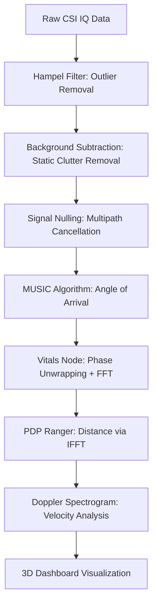

#  Phantom Scan

<p align="center">
  
</p>

## **Perceive the Invisible: Through-Wall WiFi CSI Sensing** ##

**Real-time human detection, vital signs tracking, and spatial mapping using Channel State Information.** No cameras. No infrared. Just radio waves and physics.

###  Phantom Scan is a high-performance WiFi sensing dashboard designed for stealthy environmental observability.

By analyzing disturbances in the WiFi signal field (Channel State Information), Phantom Scan reconstructs human presence, determines Angle of Arrival (AoA) for target tracking, and estimates vital signs (heart rate/breathing) with sub-millimeter precision.

Built for **Low-SWaP (Size, Weight, and Power)** edge applications, the system bridges physical hardware (ESP32-S3) with highly optimized Node.js processing pipelines and real-time 3D React visualizations.

[](https://nodejs.org/)
[](https://opensource.org/licenses/MIT)
[](#-new-in-v11)
[](#vital-sign-monitoring)

---

> | Capability | Methodology | Latency |
> |------------|-------------|---------|
> | **Through-Wall Detection** | Multipath phase analysis (Signal Nulling) | < 50ms |
> | **Vital Signs Monitoring** | Phase Unwrapping + FFT (0.1 - 2.0 Hz) | ±2 BPM Accuracy |
> | **Angle of Arrival (AoA)** | MUSIC Algorithm (Eigendecomposition) | 1° Resolution |
> | **Distance Estimation** | PDP (IFFT) + Log-Distance RSSI Model | ±0.5m Accuracy |
> | **Hardware Control** | Whitelisted Secure Task Spawner | Least-Privilege |

---

## 🚀 New in v1.1

- **Secure System Control Shell:** Whitelisted administrative task spawner (Monitor Mode toggle, reboots) with shell-injection protection.
- **Dynamic Wi-Fi Selection:** Intelligent adapter filtering automatically selects legitimate wireless interfaces.
- **WSL Diagnostic Bridge:** Seamlessly stream USB hardware telemetry into virtualized Linux environments via `usbipd-win`.
- **Enhanced Vitals DSP:** Improved phase unwrapping for more stable heart rate and breathing rate estimation.

---

## 📖 Documentation

| Document | Description |
|----------|-------------|
| [Ubuntu & ESP32-S3 Setup](docs/UBUNTU_ESP32_SETUP.md) | **Recommended** - Guide for Node.js, ESP-IDF, and CSI firmware setup |
| [Windows & ESP32-S3 Setup](docs/WINDOWS_ESP32_SETUP.md) | Guide for Node.js, ESP-IDF, and CSI firmware setup on Windows |
| [WSL Setup Guide](docs/wsl_usb_setup.md) | How to bind physical USB sensors to Windows Subsystem for Linux |
| [API Reference](#api-reference) | Technical details for REST and WebSocket interfaces |
| [Signal Logic](#-the-signal-logic) | Visualizing the 8-stage DSP pipeline |

---

## 🚀 Key Features

### 📡 Sensing & Intelligence
| | Feature | Technical Implementation |
|---|---|---|
| 🩻 | **Through-Wall Scanning** | Utilizes **EMA Background Subtraction** to remove static multipath clutter, revealing dynamic human movement behind solid barriers. |
| 🫀 | **Vital Signs Oracle** | Processes sub-millimeter chest wall movements using **Butterworth Bandpass** filtering and **Cooley-Tukey FFT** to estimate BPM and BRM. |
| 📍 | **Spatial AoA Mapping** | Employs the **MUSIC (MUltiple SIgnal Classification)** algorithm to resolve the direction of signal reflections with high angular resolution. |
| 👥 | **Occupancy Counting** | Analyzes **Spatial Variance** across subcarriers to estimate the number of unique human targets in a zone. |

### 🛠️ Control & Infrastructure
| | Feature | Technical Implementation |
|---|---|---|
| 🔒 | **Secure Task Shell** | A **shell-injection-proof** spawner that uses `child_process.spawn` with `shell: false` to execute whitelisted administrative commands. |
| 🐳 | **WSL Bridge Logic** | Routes hardware-specific diagnostic commands through **WSL** on Windows, allowing Linux-based tools to access USB hardware via `usbipd-win`. |
| 📶 | **Interface Auto-Filter** | Automatically detects and filters network adapters, presenting only valid **Wi-Fi interfaces** for monitoring. |
| ⚡ | **SSE Telemetry** | High-performance **Server-Sent Events** stream hardware logs directly to the frontend without WebSocket overhead. |

---

## 🔬 The Signal Logic

Phantom Scan transforms raw complex IQ samples into actionable environmental intelligence through an optimized 8-stage pipeline:



---

## 🏢 Use Cases

| | Why Phantom Scan wins | Industry Standard alternative |
|---|---|---|
| 🚑 | **Disaster Response** | Detects survivors under rubble via breathing rate | Thermal imaging (blocked by thick debris) |
| 🏥 | **Elderly Care** | Fall detection & vitals monitoring (no wearables) | Wearable pendants (low compliance) |
| 🔒 | **Secure Facilities** | Covert through-wall tracking without cameras | PIR Sensors (easily spoofed/blocked) |
| 🏭 | **Industrial Safety** | Worker proximity alerts in dusty/smoky zones | LIDAR (fails in poor visibility) |
| ⚔️ | **Tactical Urban Operations using Drone Recon** | Identifies hostile vs. hostage pose through concrete, Operates in smoke, fog, and GNSS-denied zones |
---

## 📦 System Architecture

### 1. Data Ingestion Layer
Supports high-speed ingestion via:
- **UDP (ADR-018):** Low-latency binary packets from custom Wi-Fi firmware on Port `5005`.
- **Serial/REST:** Batch ingestion from Python/MicroPython sensor scripts.
- **Warp Demo:** Synthetic signal generator for UI/UX testing without hardware.

### 2. WSL & Hardware Bridge
On Windows environments, the **Secure Terminal** module bridges the gap between the host and hardware:
- Uses `usbipd-win` to passthrough USB sensors.
- Wraps commands in `wsl -d Ubuntu --` to leverage Linux-only hardware drivers.
- Streams diagnostics via `EventSource (SSE)` for real-time sensor health monitoring.

### 3. Real-Time Visualization
A high-fidelity React dashboard featuring:
- **3D Point Cloud:** Absolute-positioned Three.js scene with radial radar grids.
- **Floating Monitor Widgets:** Decoupled vitals, identity, and distance gauges.
- **Live Spectrograms:** Doppler and AoA intensity maps for signal behavior analysis.

---

## 🛠️ Getting Started

### Prerequisites
- **Node.js** v18 or higher.
- **WSL (Ubuntu)** for Windows users (recommended for hardware access).
- **usbipd-win** (for USB passthrough).

### Installation
```bash
git clone https://github.com/thaerbayyri/Phantom-Scan.git
cd "phantom scan"
npm install
```

### Development
```bash
npm run dev
```
Open **http://localhost:5000** to access the dashboard. Use the **Terminal** icon in the top-bar to start the diagnostic stream.

---

## 📡 API Reference

### REST Endpoints
- `GET /api/v1/system/interfaces`: List filtered Wi-Fi adapters.
- `POST /api/v1/system/execute-task`: Run a whitelisted administrative task.
- `GET /api/v1/diagnostic/stream`: Initiate SSE telemetry stream.

### WebSocket (Port 5000)
- `vitalSigns`: Real-time BPM/BRM data.
- `csiFrame`: Raw subcarrier amplitude and phase.
- `isarFrame`: AoA spectrum peaks.

---

## License
MIT
