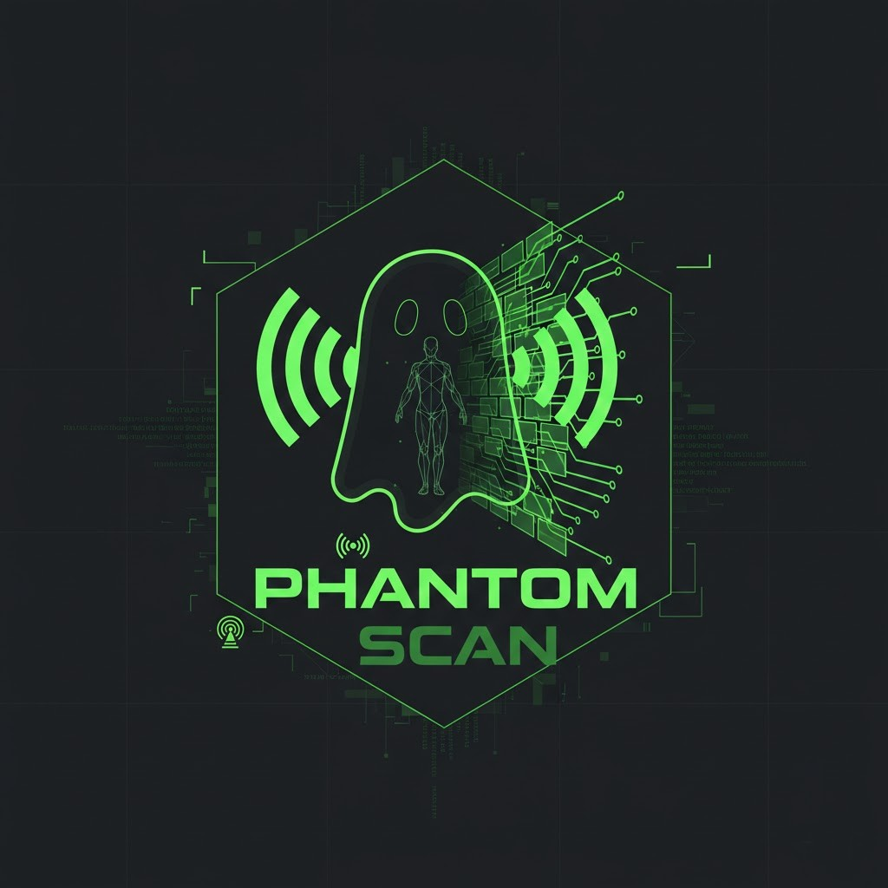

# Phantom Scan (WiVi-Vision)

**Phantom Scan** is an advanced Wi-Fi Sensing and 3D Visualization system that uses Channel State Information (CSI) from standard ESP32 devices to detect, track, and visualize human movement in real-time without cameras.



## 🚀 Key Features

*   **Real-time CSI Capture:** Streaming raw CSI data from ESP32-S3 via Serial/USB.
*   **Signal Processing Pipeline:**
    *   **Static Clutter Removal:** Dynamic Background Subtraction to isolate moving objects.
    *   **Motion Gating:** Automatically pauses rendering when no motion is detected.
    *   **Doppler Spectrogram:** Visualizes frequency shifts (speed) over time as a heatmap.
*   **Advanced Tracking:**
    *   **DBSCAN Clustering:** Groups 3D signal points to identify the target subject.
    *   **Kalman Filter:** Smooths the trajectory and predicts position during occlusions.
*   **3D Visualization:**
    *   **Signal Avatar:** Glowing 3D sphere representing the tracked subject in a virtual space.
    *   **Motion Trail:** Visualizes the path of movement.
    *   **React Three Fiber:** High-performance 3D scene rendering.

## 🛠️ Prerequisites

*   **Node.js** (v18 or later)
*   **Python** (3.10 or later)
*   **Git**
*   **Hardware:** ESP32-S3 Development Board (flashed with CSI-enabled firmware)

## 📦 Installation

1.  **Clone the repository:**
    ```bash
    git clone https://github.com/thaerbayyri/Phantom-Scan.git
    cd Phantom-Scan
    ```

2.  **Install Application Dependencies (Node.js):**
    ```bash
    npm install
    ```

3.  **Install Python Dependencies (for capture processing):**
    ```bash
    pip install pyserial requests numpy scikit-learn
    ```

## 🚀 Running the System

### 1. Start the Dashboard & Server
Run the unified backend/frontend server:
```bash
npm run dev
```
*   **Server:** Running on `http://localhost:5000`
*   **Dashboard:** Automatically opens or visit `http://localhost:5000` (proxied from Vite)

### 2. Connect the ESP32 Capture Script
Connect your ESP32-S3 via USB and find its COM port (e.g., `COM3`, `/dev/ttyUSB0`).
Run the Python capture script:
```bash
python scripts/csi_capture.py --esp32 --port COM3 --server http://localhost:5000
```
*(Replace `COM3` with your actual port)*

### 3. View Results
Open the dashboard. You should see:
*   **Status:** "Connected"
*   **Source:** "LIVE • ESP32"
*   **3D Scene:** Point cloud particles and the cyan **Signal Avatar** tracking movement.

## 📂 Data & Analysis

### Recording Sessions
*   Click the **Record** button in the dashboard top bar to start saving data.
*   Click **Stop** to finish.
*   Click the **Download** icon to save the CSV file.

### Data Format (CSV)
The recorded CSV files contain raw and processed CSI data:
```csv
timestamp, subcarrier_index, h1_re, h1_im, h2_re, h2_im, rssi
```

### Offline Analysis Script
A standalone Python script is provided to demonstrate the tracking logic (DBSCAN + Kalman) on data:
```bash
python scripts/tracking_processor.py
```
This script generates a `tracking_session.csv` with the smoothed trajectory data.

## 🔧 Troubleshooting

*   **"Download failed":** Ensure you have write permissions in the `recordings/` directory. (Fixed in latest version).
*   **Dashboard Blank/Crash:** Ensure you are using a modern browser with WebGL support for the 3D scene.
*   **No Data:** Check the USB cable and ensure the correct COM port is specified in the python script.

## 📄 License
MIT License
