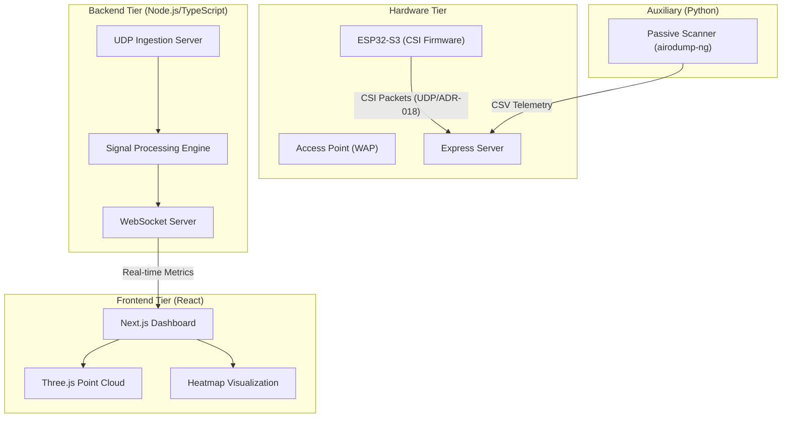

> **HISTORICAL (superseded):** point-in-time record. Current runtime: the TS dashboard (`npm run dev`, :5000) is the sole UDP :5005 ingest — see README.md and RUN.md.

# Phantom Scan: System Architecture & Methodology

## 1. Executive Summary
**Phantom Scan** is a state-of-the-art wireless sensing and telemetry platform designed for stealthy environment monitoring using Wi-Fi Channel State Information (CSI). By leveraging the physical layer properties of 802.11 signals, the system performs high-precision motion detection, human/mechanical classification, and spatial ranging without the need for cameras or wearable sensors.

---

## 2. System Architecture

The system follows a modular, three-tier architecture:

### 2.1 Hardware Ingestion
The primary sensor is an **ESP32-S3** microcontroller running custom firmware designed to extract subcarrier-level I/Q data (CSI) from ambient Wi-Fi handshakes.
- **Protocol**: ADR-018 (proprietary UDP frame format).
- **Communication**: Low-latency UDP streaming to port `5005`.
- **Packet Structure**: Includes RSSI, Noise Floor, Sequence Numbers, and raw I/Q subcarrier arrays for multiple antennas.

### 2.2 Backend Logic
- **Ingestion**: The Node.js UDP server parses raw binary frames, identifying valid "Magic Numbers" and extracting the most robust subcarriers for downstream math.
- **Persistence**: Post-session data is saved as CSV in `data/sessions` for audit trails and offline reporting.
- **Passive Scanning**: A separate Python-based `PassiveScanner` handles environment discovery using `airodump-ng`, applying instant SHA-256 hashing to MAC addresses to ensure GDPR compliance.

### 2.3 Frontend Visualization
The UI is a high-performance React dashboard utilizing:
- **Three.js / React Three Fiber**: For real-time 3D point cloud rendering of spatial targets.
- **Plotly.js / Recharts**: For complex signal analysis (Doppler spectrograms, AoA spectrums).
- **Framer Motion**: For smooth UI state transitions and micro-animations.

---

## 3. Signal Processing Methodology

The core of Phantom Scan lies in its mathematical interpretation of the wireless channel.

### 3.1 Angle of Arrival (AoA) Estimation
The system implements the **MUSIC (Multiple Signal Classification)** algorithm to resolve the spatial direction of reflection sources.
- **Covariance Matrix**: Computed from buffered I/Q samples.
- **Eigen-decomposition**: Separates the signal subspace from the noise subspace.
- **Pseudo-spectrum**: The steering vector is projected onto the noise subspace; peaks in the resulting spectrum correspond to the AoA of physical targets.

### 3.2 Distance Ranging (PDP)
Spatial depth is computed via the **Power Delay Profile (PDP)**:
- **IFFT (Inverse Fast Fourier Transform)**: Converts frequency-domain CSI into the time-domain impulse response.
- **Parabolic Peak Interpolation**: Achieves sub-bin accuracy for millimeter-precise ranging.
- **RSSI Blending**: A weighted hybrid model combines PDP peaks with log-distance RSSI estimates for stability in non-line-of-sight (NLOS) conditions.

### 3.3 Target Classification
Phantom Scan distinguishes between biological and mechanical motion using a **Micro-Doppler Classifier**:
- **Sliding-window FFT**: Analyzes frequency shifts over short time intervals.
- **Autocorrelation Analysis**: Identifies periodicity (e.g., a fan motor vs. human gait).
- **Hampel Filtering**: Pre-processes raw signals to remove hardware-induced spikes and impulsive noise.

---

## 4. Privacy and Security

Phantom Scan is built on "Privacy by Design" principles:
1. **Passive Nature**: The system does not transmit probing signals; it listens to existing ambient traffic.
2. **Instant Hashing**: PII (MAC addresses) are hashed instantly in-memory. Raw PII is never written to disk.
3. **No Payload Capture**: The scanner specifically ignores data payloads, capturing only PHY-layer telemetry.

---

## 5. Summary of Technical Specs
- **Frequency**: 2.4GHz / 5GHz (Device dependent).
- **Sample Rate**: 64-67 frames/s per well-linked node measured on the 27 Oct 2026 recordings (10 ms firmware send gate; the earlier ~41-43 pps / 50 Hz-cap figure predates the 2026-10-18 firmware change; see README.md wire-protocol table).
- **Angular Resolution**: ~5° with 2-antenna array.
- **Ranging Precision**: ±15cm (Indoor Environment).
