# APPENDICES - Complete Hand-Off Draft for the Final Report

> This document contains ALL appendices for `Final-Phantom-Scan-Project-Report.docx`:
> Appendices A-E (source code) are already generated inside the DOCX - here they are
> represented by their introductions and per-file maps. Appendices F-I are the
> additional sections to add manually to the DOCX.

**Appendix overview:**

| Appendix | Title | Status in DOCX |
|---|---|---|
| A | ESP32-S3 Firmware Source | Already generated (full code, 29 files) |
| B | Host Runtime and Shared Contracts | Already generated (full code, 22 files) |
| C | Operator Dashboard Client | Already generated (full code, 32 files) |
| D | Python Replay and DSP Toolkit | Already generated (full code, 8 files) |
| E | Key Tooling Scripts | Already generated (full code, 7 files) |
| F | Dashboard User Interface Screenshots | Add manually (images below) |
| G | Hardware Configuration and Deployment Geometry | Add manually |
| H | Test and Verification Evidence | Add manually |
| I | Run and Installation Guide | Add manually |

---

## Appendices A-E: Source Code

*Introduction (already printed in the DOCX):* The appendices reproduce the complete source code of the Phantom Scan implementation as of the current verified repository state. Automated test files (`*.test.ts` and the `tests/` package) are summarized in Chapter 7 rather than reprinted; all runtime source is included verbatim. The file maps below describe every included file, in appendix order.

## Appendix A - ESP32-S3 Firmware Source (`firmware/esp32-csi-node/main/`)

| File | Description |
|---|---|
| `CMakeLists.txt` | ESP-IDF component build definition listing the firmware source files and dependencies. |
| `csi_collector.c` | Core CSI capture: enables promiscuous WiFi mode, registers the CSI callback, runs the ~50 Hz gateway self-ping that keeps CSI flowing on quiet networks, serializes each measurement into the ADR-018 32-byte binary frame (magic 0xC5110001), and rate-limits transmission to 50 Hz. |
| `csi_collector.h` | Public interface and frame-format constants for the CSI collector. |
| `display_hal.c` | Hardware abstraction for the optional on-board display panel (SPI init, backlight, flush callbacks). |
| `display_hal.h` | Display HAL interface definitions. |
| `display_task.c` | FreeRTOS task driving the optional display: refresh loop and screen state updates. |
| `display_task.h` | Display task interface. |
| `display_ui.c` | LVGL user-interface screens for the on-device display (node status, packet counters). |
| `display_ui.h` | Display UI interface. |
| `edge_processing.c` | On-board "edge DSP" tier: computes the node's own motion/presence/respiration/heart-rate estimates and emits the 1 Hz feature-state packet (magic 0xC5110006) shown in the dashboard's Board DSP card. |
| `edge_processing.h` | Edge-processing interface and configuration. |
| `lv_conf.h` | LVGL graphics library configuration for the display build. |
| `main.c` | Firmware entry point: loads NVS configuration and caches the node_id before WiFi starts (prevents node identity mix-ups), joins the network with power-save disabled, and starts the collector, sender, heartbeat, and optional subsystems. |
| `nvs_config.c` | Non-volatile storage configuration: reads/writes node_id, WiFi credentials, and host target from NVS flash. |
| `nvs_config.h` | NVS configuration interface. |
| `ota_update.c` | Over-the-air firmware update support (optional subsystem). |
| `ota_update.h` | OTA update interface. |
| `power_mgmt.c` | Power-management helpers (optional; the sensing path runs with power-save disabled for maximum CSI yield). |
| `power_mgmt.h` | Power-management interface. |
| `rv_feature_state.c` | Builder/serializer for the RuView feature-state packet carrying board-side presence, motion, respiration, and heart-rate values. |
| `rv_feature_state.h` | Feature-state packet structure definitions. |
| `rvf_parser.c` | Parser for RuView-format (RVF) records used by the board-side DSP path. |
| `rvf_parser.h` | RVF parser interface. |
| `stream_sender.c` | UDP transport: socket to the configured host:5005, 32-slot FreeRTOS queue with a dedicated sender task, and ENOMEM backoff so lwIP buffer exhaustion degrades throughput instead of crashing the node. |
| `stream_sender.h` | Stream-sender interface. |
| `wasm_runtime.c` | Experimental WebAssembly runtime for uploadable edge-processing modules (off by default). |
| `wasm_runtime.h` | WASM runtime interface. |
| `wasm_upload.c` | Endpoint for receiving WASM module uploads to the experimental runtime. |
| `wasm_upload.h` | WASM upload interface. |

## Appendix B - Host Runtime and Shared Contracts (`server/`, `shared/`)

| File | Description |
|---|---|
| `server/audit/logger.ts` | Append-only JSONL audit trail for security-relevant events (logins, source-pinning rejections, privileged actions). |
| `server/auth/service.ts` | Operator authentication service: scrypt-hashed local credentials, first-operator bootstrap seeding, session/token issuing. |
| `server/auth/ws-auth.ts` | WebSocket handshake authentication - validates the operator's JWT/cookie session before any live data flows. |
| `server/index.ts` | Express application bootstrap: HTTP server, routes, WebSocket layer, and UDP ingest startup. |
| `server/lib/complex.ts` | Complex-number arithmetic helpers (add, multiply, conjugate, magnitude) used by the DSP chain. |
| `server/lib/node-fusion.ts` | **The detector.** Pure functions for per-subcarrier turbulence motion (`computeNodeMotionFromMatrix`), the empty-room gate (default 0.12), contrast-sharpened two-node balance fusion (`fuseTwoNodeTarget`, p = 2.0), display bias, and approach/recede trend hysteresis. |
| `server/lib/recording-export.ts` | CSV export of recorded sessions with the positional-fidelity column contract (gate state, balance, distances, ground-truth join). |
| `server/lib/session-store.ts` | Persistent store for scan sessions/cases and their recorded artifacts. |
| `server/lib/signal-processing.ts` | Legacy single-node DSP helpers: background clutter subtraction, motion gate, MUSIC AoA spectrum, point-cloud generation, PDP ranging, micro-Doppler classification. |
| `server/lib/target-state.ts` | Honest target-state machine: none/stale/idle/moving/degraded, node_mode, position confidence (>= 0.45), 1.5 s stale hold, 5 s hard clear. |
| `server/lib/tracking.ts` | DBSCAN clustering + Kalman filter tracker for point-cloud targets. |
| `server/lib/udp-server.ts` | Sole owner of UDP :5005. Parses ADR-018 CSI frames, heartbeats (0xC51100A1), and feature-state packets (0xC5110006); computes per-subcarrier amplitudes; `SourcePinningGuard` rejects spoofed node identities. |
| `server/lib/vitals.ts` | Phase-based respiration and heart-rate estimation from the cross-channel term h1 x conj(h2). |
| `server/lib/websocket.ts` | Pipeline orchestrator (`SignalProcessingServer`): 50 ms processing loop, per-node 1500 ms amplitude windows, fusion invocation, per-tick fused snapshot, and broadcast of all WebSocket message types. |
| `server/routes.ts` | HTTP API routes: auth, session/case management, recording control, report generation triggers. |
| `server/static.ts` | Static-file serving for the production dashboard build. |
| `server/storage.ts` | Storage abstraction for operator records and app data. |
| `server/vite.ts` | Vite dev-server middleware integration for development mode. |
| `shared/bearing.ts` | Compass/bearing conventions shared by server and client (theta = compass bearing, angle = travel direction). |
| `shared/schema.ts` | **The contract layer.** Zod schemas and TypeScript types for every WebSocket message (RadialTarget, TargetState, SensorNode, NodeFeatureState, ...) plus the geometry constants `NODE_ANCHORS` (N1 -1.5 m, N2 +1.5 m) and `NODE_SEPARATION_M = 3`. |
| `shared/target-presentation.ts` | Presentation-honesty helpers (`canPresentLiveTargetPosition`, `canPresentTruthfulTarget`, `getLivePositionCaveat`) that gate what the UI may draw. |
| `shared/target-spatial.ts` | Human-readable spatial summaries of the fused target (between-nodes phrasing, nearest node, axis-only labeling). |

## Appendix C - Operator Dashboard Client (`client/src/`)

| File | Description |
|---|---|
| `App.tsx` | Root component: router, auth provider, query client, and page layout. |
| `components/dashboard/aoa-heatmap.tsx` | Time-versus-angle AoA heat map built from successive MUSIC spectra. |
| `components/dashboard/aoa-spectrum.tsx` | MUSIC pseudo-spectrum line plot with dominant-peak marker. |
| `components/dashboard/control-panel.tsx` | Operator controls for processing/display configuration. |
| `components/dashboard/DirectionalNode.tsx` | 3D marker for the fused target with direction indication in the radar scene. |
| `components/dashboard/distance-meter.tsx` | Radial range gauge (0-8 m) with digital distance to nearest node and compass bearing chip. |
| `components/dashboard/doppler-spectrogram.tsx` | Time-versus-frequency Doppler spectrogram of the live channel. |
| `components/dashboard/HumanMesh.tsx` | Human silhouette mesh rendered only when a truthful volumetric presentation is permitted. |
| `components/dashboard/MachineStatic.tsx` | Scene entity for mechanically-classified (non-human) targets. |
| `components/dashboard/metrics-panel.tsx` | Numeric tiles: h1/h2 magnitude, precoding \|p\|, peak AoA. |
| `components/dashboard/node-features-card.tsx` | "Board DSP" card showing the firmware's own 1 Hz feature-state verbatim, independent of host fusion; explicitly reports packet absence. |
| `components/dashboard/point-cloud-3d.tsx` | Full-screen React-Three-Fiber canvas hosting the radar scene and point cloud. |
| `components/dashboard/RadialScene.tsx` | The central radar scene: polar grid, N1/N2 beacons with motion-driven ripples, node axis, fused target sphere, travel arrow, axis-projection caveat. |
| `components/dashboard/scan-controller.tsx` | Scan session control (start/stop, case handling, recording). |
| `components/dashboard/target-identity-card.tsx` | Target Identity card: moving/idle badges, human-versus-mechanical classifier bar with periodicity/HF features, fused-axis distances and trend, on-axis warning. |
| `components/dashboard/top-bar.tsx` | Top status/command bar: connection, data-source badges, counters, case chip, Motion pill, REC control, session commands. |
| `components/dashboard/vitals-monitor.tsx` | Heart-rate/respiration panel with confidence bars and CALIBRATING state. |
| `hooks/use-auth.tsx` | Authentication context/hook: login state, session refresh, guarded routes. |
| `hooks/use-mobile.tsx` | Responsive-layout hook detecting small screens. |
| `hooks/use-toast.ts` | Toast notification hook. |
| `hooks/use-websocket.ts` | Live-state hook: typed WebSocket subscription for all message types with a 5 s client-side staleness watchdog that wipes the scene on silence. |
| `lib/complex.ts` | Client-side complex-number helpers for spectral displays. |
| `lib/queryClient.ts` | TanStack Query client and API fetch helpers. |
| `lib/utils.ts` | Shared UI utilities (class-name merging, formatting). |
| `main.tsx` | Client entry point mounting the React app. |
| `pages/activity.tsx` | Activity log page (audit/operational events). |
| `pages/dashboard.tsx` | Main live dashboard page: composes all panels and routes every render decision through the shared presentation-honesty helpers. |
| `pages/history.tsx` | Session/case history browser. |
| `pages/login.tsx` | Operator login page. |
| `pages/not-found.tsx` | 404 fallback page. |
| `pages/report.tsx` | Generated scan-report viewer. |
| `react-plotly.d.ts` | TypeScript declarations for the Plotly React binding. |

## Appendix D - Python Replay and DSP Toolkit (`phantom/`)

| File | Description |
|---|---|
| `__init__.py` | Package initializer and public exports. |
| `ai_status.py` | Probes the optional AI sidecar and reports DSP-only versus AI-assisted status (advisory path, disabled by default). |
| `api.py` | Lightweight REST status API for the Python runtime (`RuntimeApiServer`). |
| `dsp.py` | Reference DSP: amplitude/phase extraction, static-clutter suppression (EMA), Hampel outlier filter, respiration band-pass, motion energy, cross-node correlation, dual-node on-axis position, deterministic human gate. |
| `ingest.py` | UDP packet source, per-node buffers, and the Python mirror of the source-pinning guard. |
| `protocol.py` | Binary protocol parser for ADR-018 CSI frames and heartbeats - byte-for-byte parity with the TypeScript parser, locked by shared fixtures. |
| `recording.py` | JSONL session writer/reader (session_header, csi_frame, heartbeat, derived_frame, session_footer records). |
| `runtime.py` | `PhantomRuntime`: live and replay modes, single/fused node handling; live UDP authority is gated behind `PHANTOM_USE_AUTHORITY=1` so it never collides with the dashboard on :5005. |

## Appendix E - Key Tooling Scripts (`scripts/`)

| File | Description |
|---|---|
| `calibrate-threshold.ts` | Empty-room calibration tool: runs the exact production parse-window-motion pipeline on live packets and reports mean + 3/4/5-sigma candidates for `PHANTOM_MOTION_THRESHOLD`. |
| `ruview-dashboard-bridge.py` | The original standalone RuView two-node bridge from which the TypeScript balance fusion was ported; retained as a bench diagnostic. |
| `record-csi-udp.py` | Records live UDP CSI traffic to file for later replay and analysis. |
| `replay_to_dashboard.py` | Replays a recorded session into the live ingest so the dashboard can be exercised without hardware. |
| `synth-csi-udp.py` | Generates synthetic CSI streams for development and negative testing (never presented as live data). |
| `csi_filter_pipeline.py` | Offline CSI filtering/analysis pipeline for recorded CSV data. |
| `csi_capture.py` | General-purpose CSI capture utility for bench sessions. |

---

## Appendix F - Dashboard User Interface Screenshots

The following screenshots document the live operator dashboard during a real two-node scan session (case "scan 01 test", both ESP32-S3 nodes streaming). Section 5.5 describes how each component is read.

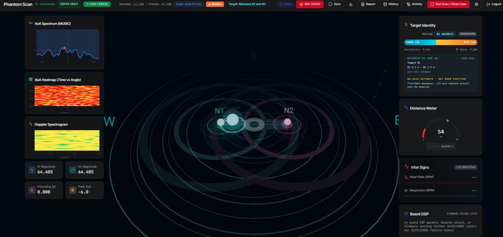
*Figure F.1: The complete live operator dashboard during a two-node scan session.*

*Figure F.2: Top status and command bar - Connected link, LIVE ESP32 source badges, sample/frame counters, active case, Motion gate pill, target summary, recording control, and session commands.*

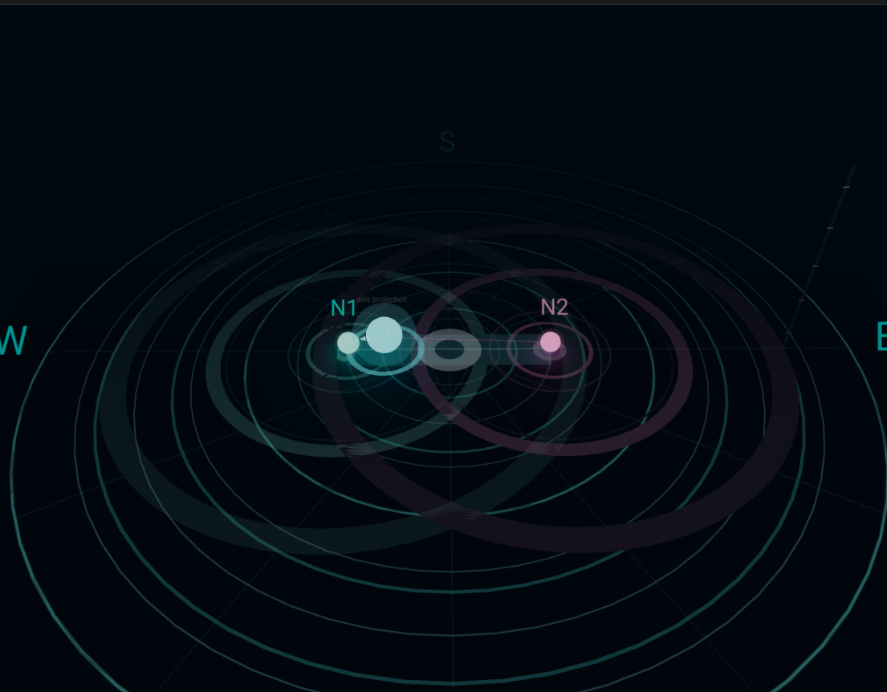
*Figure F.3: Central radar scene - N1 (cyan) and N2 (pink) node beacons with motion-driven ripples, the localization axis, and the fused target sphere with its "axis projection" caption.*

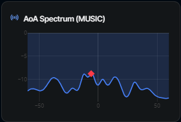
*Figure F.4: AoA Spectrum (MUSIC) - power versus angle with the dominant peak marked.*

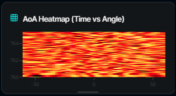
*Figure F.5: AoA Heatmap - angle spectra stacked over time.*

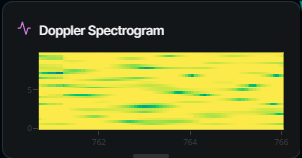
*Figure F.6: Doppler Spectrogram - time-versus-frequency motion energy.*

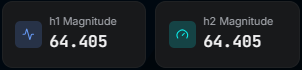
*Figure F.7: h1 / h2 Magnitude tiles - live channel amplitude health check.*

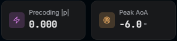
*Figure F.8: Precoding |p| and Peak AoA tiles.*

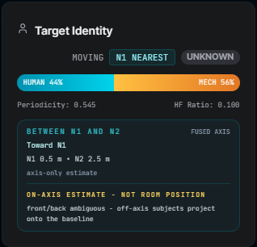
*Figure F.9: Target Identity card - moving/nearest badges, human-versus-mechanical classifier bar, fused-axis distances and trend, and the permanent on-axis warning.*

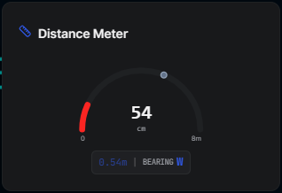
*Figure F.10: Distance Meter - range gauge with digital readout and bearing chip.*

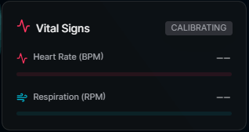
*Figure F.11: Vital Signs panel in the CALIBRATING state - honest dashes instead of fabricated numbers.*

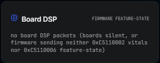
*Figure F.12: Board DSP card - firmware feature-state readout, here explicitly reporting that no board packets are arriving.*

---

## Appendix G - Hardware Configuration and Deployment Geometry

**G.1 Bill of materials**

| Item | Quantity | Role |
|---|---|---|
| ESP32-S3 development board (single antenna) | 2 | CSI sensing nodes N1 and N2 |
| USB cables / 5 V supplies | 2 | Node power (USB from laptop or wall adapter) |
| 2.4 GHz WiFi router | 1 | Shared network; CSI is measured on traffic to/from its gateway |
| Laptop (Windows 11) | 1 | Host: live ingest, fusion, dashboard |

**G.2 Node provisioning (verified session of July 8, 2026)**

| Parameter | Node N1 | Node N2 |
|---|---|---|
| node_id (NVS, cached before WiFi start) | 1 | 2 |
| Serial port during flashing | COM5 | COM6 |
| DHCP address in verified session | 192.168.1.133 | 192.168.1.238 |
| Network | operator 2.4 GHz WLAN (SSID redacted) | operator 2.4 GHz WLAN (SSID redacted) |
| Stream target | laptop-IP:5005 (UDP) | laptop-IP:5005 (UDP) |
| Firmware send rate | 50 Hz cap, ~41-43 pkt/s observed | 50 Hz cap, ~41-43 pkt/s observed |

**G.3 Deployment geometry**

The two nodes are placed 3 m apart at similar height with clear line to the monitored area. The system's world frame fixes N1 at (-1.5, 0) and N2 at (+1.5, 0) with the origin at the midpoint (constants `NODE_ANCHORS` in `shared/schema.ts`). All localization output is a position on the N1-N2 line segment; the monitored corridor is the region around that baseline.

*(Insert photographs here: each board in place, the 3 m baseline with tape measure, and the laptop host running the dashboard.)*

---

## Appendix H - Test and Verification Evidence

**H.1 Automated test matrix (July 8, 2026 - all passing)**

| Check | Result |
|---|---|
| TypeScript test suite (`tsx --test server/**/*.test.ts`) | 91 tests passed |
| Python test suite (`pytest tests/`) | 82 passed, 1 hardware-conditional skip |
| TypeScript typecheck (`tsc`) | Clean |
| Production build | Clean |

**H.2 What the suites verify**

| Suite | Coverage |
|---|---|
| `udp-server.test.ts` | ADR-018 32-byte frame parsing against committed binary fixtures; heartbeat exclusion; source-pinning accept/reject (foreign source, board reboot, DHCP renumber); feature-state decoding |
| `node-fusion.test.ts` | Balance localization extremes and midpoint; empty-room returns no target; per-subcarrier matrix motion; contrast exponent; trend hysteresis |
| `target-state.test.ts` | Freshness windows, degraded labeling, stale demotion (1.5 s) and hard clear (5 s), confidence gating |
| `target-presentation` / `target-spatial` tests | Honesty caveats and spatial summaries |
| `recording-export` / ground-truth tests | CSV column contract, gate-closed suppression |
| `bearing` / `pose-anchor` / auth tests | Compass conventions, rendering regressions, scrypt seeding, audit ordering |
| pytest protocol/pipeline/runtime | Byte-level protocol parity with TypeScript; DSP pipeline over real recordings; replay roundtrip; spoof rejection; degraded/fused transitions |
| `tests/test_invariants.py` | Dual-node midpoint invariant; AI firewall (AI input cannot change the deterministic gate); no upstream hardware controls from the dashboard; UAV/flight-control scope guard |

**H.3 Live hardware session (July 8, 2026)**

- Two ESP32-S3 boards streaming simultaneously: ~200 packets per 5 s interval (~40 pkt/s aggregate) into the live ingest.
- RSSI envelope -23 to -38 dBm; firmware-reported yield 41-43 pkt/s per node (preflight minimum: 20 pkt/s per node).
- Node identity confirmed cached before WiFi start on both boards.
- **Spoofing drill:** ~640 packets claiming both node identities injected from a foreign source - all rejected by the source-pinning guard with four rate-limited security log entries; real streams unaffected.

**H.4 Honest pending items**

Detection rate, false-positive rate, on-axis localization error versus tape-marked ground truth, and respiration/heart-rate accuracy versus reference sensors are defined in the measurement protocols (`MEASUREMENT_PLAN.md`, `REAL_TEST_REPORT.md`) and remain `[TO BE MEASURED]` in live campaigns. The project's honesty rules forbid substituting software runs or single anecdotal sessions for these numbers.

---

## Appendix I - Run and Installation Guide

**I.1 Prerequisites**

- Node.js 18+ and npm on the host laptop.
- Python 3.13 for the report/tooling scripts; the project virtual environment (`.venv`) for the Python runtime and tests.
- ESP-IDF toolchain (or the provided flashing script) for firmware work.
- Both ESP32-S3 boards and the host laptop on the same 2.4 GHz network.

**I.2 Flashing and provisioning the nodes**

1. Build the firmware in `firmware/esp32-csi-node/` (ESP-IDF; a Docker build path is documented in the firmware README).
2. Provision each board's identity with the prepared NVS images: `nvs_node1.csv/.bin` for N1, `nvs_node2.csv/.bin` for N2 (node_id, WiFi credentials, host IP:5005 target) using `esp-flash.py` on the board's COM port.
3. Verify on the serial monitor that the node reports its node_id before WiFi connects and that CSI yield reaches >= 20 pkt/s.

**I.3 Starting the dashboard host**

1. `npm install` (first time only), then `npm run dev` in the repository root - this launches the Express server, the UDP ingest on :5005, the WebSocket layer, and the Vite dashboard in one command.
2. Open the dashboard in a browser, log in with the local operator account (created on first run), and confirm the top bar shows Connected / LIVE - ESP32 with rising frame counters once the boards stream.
3. Do not run the Python live authority at the same time; it is gated behind `PHANTOM_USE_AUTHORITY=1` precisely because both would contend for UDP :5005.

**I.4 Calibrating the detection gate (per room)**

1. Stop the dashboard (the calibration tool needs port :5005).
2. With the room empty, run `scripts/calibrate-threshold.ts`; it records a baseline through the exact production pipeline and prints mean + 3/4/5-sigma threshold candidates.
3. Set the chosen value via the `PHANTOM_MOTION_THRESHOLD` environment variable and restart the dashboard. Validate with a negative control (fan/curtain must not trigger) and a positive control (person walking the axis must trigger).

**I.5 Recording and replay**

- Recording is controlled from the dashboard top bar (REC); sessions are stored as JSONL/CSV under `data/sessions/` and can be exported as CSV.
- `scripts/replay_to_dashboard.py` replays a recorded session into the live ingest for demonstration or debugging without hardware.

**Tunable environment variables:** `PHANTOM_MOTION_THRESHOLD` (empty-room gate, default 0.12), `PHANTOM_MOTION_WINDOW_MS` (motion window, default 1500), `PHANTOM_BALANCE_CONTRAST` (balance exponent, default 2.0), `PHANTOM_TREND_DEADBAND_MPS` (trend deadband, default 0.05).
