# 5.5 User Interface (UI) Design

> Hand-off draft for the Chapter 5 DOCX. Each dashboard component is described with
> **What it presents** and **How the operator reads it**, matching the live dashboard
> layout and the components under `client/src/components/dashboard/`.

## 5.5.1 Layout and Reading Order

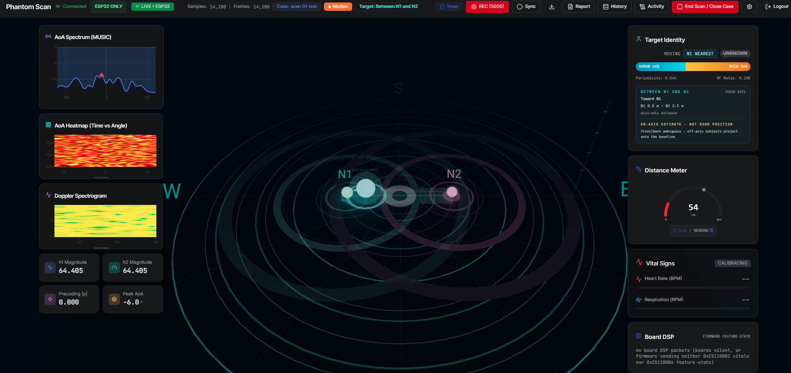
*Figure 5.2: The Phantom Scan live operator dashboard during a two-node scan session.*

The dashboard is a single-screen, dark-themed operator console organized into four zones: a status-and-command bar across the top, a signal-analysis column on the left, the central 3D radar scene, and a target-evidence column on the right. The zones are ordered by how an operator should reason: first confirm the data chain is live (top bar), then observe the spatial picture (radar scene), then consult the physical-layer evidence behind it (left column) and the derived target interpretation (right column).

## 5.5.2 Top Status and Command Bar (`top-bar.tsx`)

*Figure 5.3: Top status and command bar - connection, data source, counters, case, motion gate, recording, and session commands.*

**What it presents.** The trust context for everything below it. From left to right: the WebSocket link state ("Connected"); the data-source badges "ESP32 ONLY" and "LIVE - ESP32", which assert that no synthetic or replay source is feeding the display; live counters of ingested samples and CSI frames (e.g. 14,100 / 14,100); the active case name ("Case: scan 01 test" - recordings are organized per case); a "Motion" pill that lights only while the empty-room detection gate is open; a summary chip of the current target readout ("Target: Between N1 and N2"); the logged-in operator identity; and the recording control with a live frame count (REC 5000). Command buttons (Sync, export, Report, History, Activity, End Scan / Close Case, settings, Logout) group the session workflow in one place.

**How the operator reads it.** Before trusting any visualization, the operator glance-checks three things: the link is Connected, the source badge says LIVE ESP32, and the frame counter is rising. Together these prove real hardware data is flowing. The Motion pill is the fastest yes/no answer to "is anything moving right now", because it mirrors the detector gate itself. The REC counter confirms the session is being persisted for later replay and evidence.

## 5.5.3 Central Radar Scene (`RadialScene.tsx`, `point-cloud-3d.tsx`)

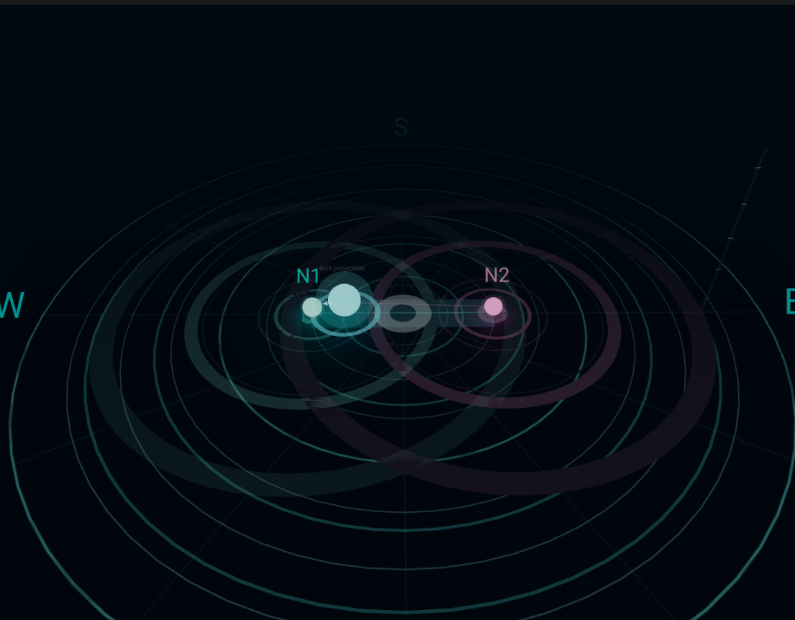
*Figure 5.4: Central radar scene - N1 (cyan) and N2 (pink) beacons, the localization axis, and the fused target sphere with its "axis projection" caption.*

**What it presents.** The spatial truth model on a polar grid with compass labels (N/S/E/W). Each ESP32 node appears as a glowing beacon at its fixed anchor - node N1 in cyan at (-1.5, 0), node N2 in pink at (+1.5, 0) - and each beacon's glow and ripple frequency are driven by that node's live motion metric, so the beacons themselves are instruments, not decoration. The line between the beacons is the valid localization axis; the fused target is drawn as a sphere on that line with connector lines to both nodes, a travel-direction arrow along the axis, and a small "axis projection" caption attached to it.

**How the operator reads it.** The target sphere's position along the N1-N2 line is the balance-fusion output: in the reference capture the sphere sits close to N1, matching the per-node readout of 0.5 m to N1 and 2.5 m to N2. Stronger ripples on one beacon mean that node is seeing more channel perturbation - a direct visual cross-check of the balance, since the sphere should sit nearer the livelier beacon. An empty scene with calm beacons means the motion gate is closed (empty room); the absence of a target is itself information. A dimmed or missing beacon indicates a silent node, and the scene relabels itself for degraded single-node mode instead of showing a fused target.

## 5.5.4 Signal-Analysis Panels (Left Column)

These panels expose the physical-layer evidence behind the detection. The AoA panels are computed by the host MUSIC pipeline and are advisory on live single-antenna hardware (fully meaningful on replay or synthetic multi-antenna inputs); the Doppler and magnitude readouts reflect the live channel directly.

### AoA Spectrum (MUSIC) - `aoa-spectrum.tsx`

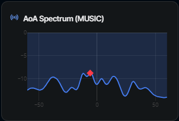
*Figure 5.5: AoA Spectrum (MUSIC) - power versus angle with the dominant peak marked.*

**What it presents.** The MUSIC pseudo-spectrum: signal power versus angle across -60 to +60 degrees, with a red marker on the dominant peak.

**How the operator reads it.** A sharp peak marks the candidate direction of the strongest reflector; a flat or jittery curve means no stable directional structure. On live single-antenna nodes it is treated as advisory texture, not position truth.

### AoA Heatmap (Time vs Angle) - `aoa-heatmap.tsx`

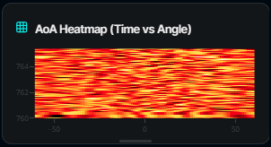
*Figure 5.6: AoA Heatmap - angle spectra stacked over time.*

**What it presents.** The same angle spectra stacked over time as a time-versus-angle heat map (hot colors = high power).

**How the operator reads it.** A persistent hot band at one angle indicates a stable dominant path; a band that drifts across the image indicates movement across angles; uniform speckle (as in an empty or noisy scene) means no persistent direction.

### Doppler Spectrogram - `doppler-spectrogram.tsx`

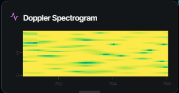
*Figure 5.7: Doppler Spectrogram - time-versus-frequency channel energy.*

**What it presents.** Time-versus-frequency energy from a sliding-window DFT of the channel series.

**How the operator reads it.** A quiet scene concentrates energy near zero frequency; human motion appears as irregular broadband bursts; strictly periodic striping suggests mechanical motion such as a fan - the same cue the identity classifier uses to separate human from mechanical movers.

### h1 / h2 Magnitude tiles

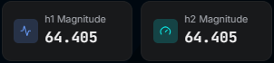
*Figure 5.8: h1 / h2 Magnitude tiles - live channel amplitude health check.*

**What it presents.** The current best-subcarrier channel amplitude for the two logical channels (e.g. 64.405 / 64.405).

**How the operator reads it.** Steady values indicate a calm channel; visible jumping tracks perturbation. Matching, non-zero values on both tiles is a quick health check that both channel estimates are alive.

### Precoding |p| tile

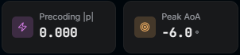
*Figure 5.9: Precoding |p| and Peak AoA tiles (the crop shows both; the two subsections below describe them in turn).*

**What it presents.** The magnitude of the cross-channel term h1 x conj(h2) that feeds the phase-based vitals processing.

**How the operator reads it.** Near zero when no target modulates the phase relation between the channels; rising values indicate usable phase structure for respiration analysis.

### Peak AoA tile

**What it presents.** The numeric angle of the current spectrum peak (e.g. -6.0 degrees).

**How the operator reads it.** A numeric companion to the AoA spectrum, useful for logging and cross-checking; a stable value over time matters more than any single reading.

## 5.5.5 Target-Evidence Panels (Right Column)

These panels translate signal evidence into the operator-facing target story, with every claim qualified by its honesty caveats.

### Target Identity card - `target-identity-card.tsx`

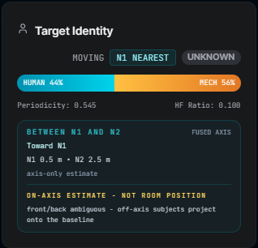
*Figure 5.10: Target Identity card - status badges, human/mechanical evidence bar, fused-axis block, and the permanent on-axis warning.*

**What it presents.** Status badges (MOVING/IDLE, nearest node such as "N1 NEAREST", identity label such as "UNKNOWN"); a human-versus-mechanical bar from the micro-Doppler classifier (e.g. HUMAN 44% / MECH 56%) together with its underlying features (Periodicity 0.545, HF Ratio 0.100); and the fused-axis block: position summary ("BETWEEN N1 AND N2", "FUSED AXIS"), trend ("Toward N1"), and per-node distances ("N1 0.5 m - N2 2.5 m", labeled "axis-only estimate"). Beneath it, a permanent warning: "ON-AXIS ESTIMATE - NOT ROOM POSITION: front/back ambiguous - off-axis subjects project onto the baseline."

**How the operator reads it.** The badges give the headline state at a glance. The classifier bar is read as weight of evidence, not a verdict - HUMAN 44% / MECH 56% with low periodicity reads as "moving, identity uncertain", so the operator should not over-trust either label. The distances are along-axis values, and the always-visible warning reminds the operator that a person walking off the baseline is projected onto it, so the readout must never be interpreted as a free-room 2D position.

### Distance Meter - `distance-meter.tsx`

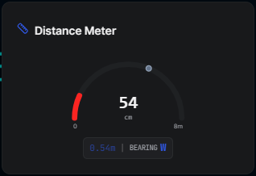
*Figure 5.11: Distance Meter - range gauge with digital readout and bearing chip.*

**What it presents.** A radial gauge (0-8 m) with the digital range to the nearest node (e.g. 54 cm) and a compass bearing chip (e.g. "0.54m | BEARING W").

**How the operator reads it.** This is the primary "how far" readout: the needle and digital value give range to the nearest node, and the bearing chip gives the compass direction of the projected position in the scene's frame. It is read together with the radar sphere - the two must agree, because both are driven by the same per-tick fused snapshot on the server.

### Vital Signs - `vitals-monitor.tsx`

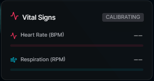
*Figure 5.12: Vital Signs panel in the CALIBRATING state - honest dashes instead of fabricated numbers.*

**What it presents.** Heart rate (BPM) and respiration (RPM) estimates from the phase-based DSP path, each with a confidence bar, plus a CALIBRATING badge while the analysis window fills.

**How the operator reads it.** Dashes ("--") mean the estimator has not yet reached confidence - a deliberate honest placeholder instead of a fabricated number. Values are trusted only once the CALIBRATING badge clears and the confidence bars fill; vitals estimation additionally requires a relatively still subject, so during active movement the dashes are the expected, correct display.

### Board DSP card - `node-features-card.tsx`

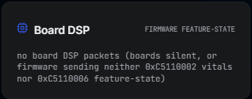
*Figure 5.13: Board DSP card - firmware feature-state readout, here explicitly reporting that no board packets are arriving.*

**What it presents.** The firmware's own on-board estimates, decoded verbatim from the ESP32's 1 Hz feature-state packets (magic 0xC5110006) and vitals packets (magic 0xC5110002): presence, motion, respiration, and heart rate per node, with packet age. When nothing arrives, the card states exactly that: "no board DSP packets (boards silent, or firmware sending neither 0xC5110002 vitals nor 0xC5110006 feature-state)".

**How the operator reads it.** This is an independent second opinion computed on the ESP32 itself and never merged into host fusion. Agreement between the board's presence/motion values and the host detector raises confidence; disagreement flags a calibration or firmware issue worth investigating. The explicit "no packets" message is part of the design: the absence of board data is stated, not hidden behind an empty panel.

## 5.5.6 State-Honest Rendering Rules

Two design rules bind all panels together. First, **single-source truth**: the radar sphere, the Target Identity distances, and the Distance Meter all read the same per-tick fused snapshot, so no two panels can disagree about where the target is. Second, **state-honest rendering**: every component consults the shared presentation helpers (`canPresentLiveTargetPosition`, `canPresentTruthfulTarget`, `getLivePositionCaveat`) before drawing, so degraded, stale, or gated states change *what is drawn* - targets vanish, beacons dim, caveat labels appear - rather than merely changing a status string. Supporting routes (login, history, activity, report) carry the session workflow outside the live screen.
