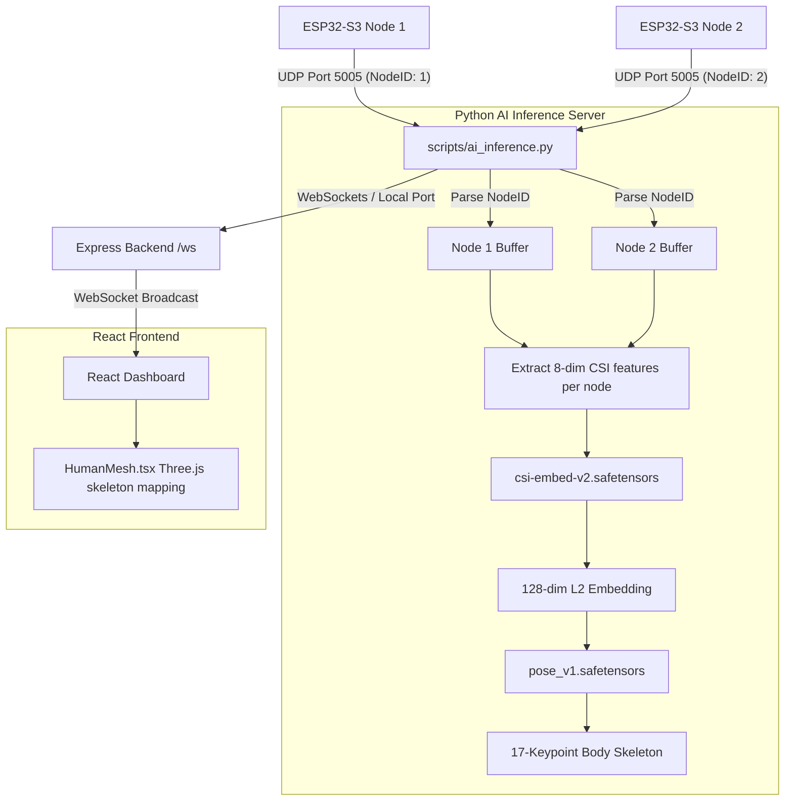

# RuView AI Models & Multi-Node Pose Integration Plan

This plan details how to integrate the RuView models (`csi-embed-v2` and `pose_v1` DensePose) into the Phantom Scan project to enable high-fidelity presence detection, activity classification, and real-time 3D human pose reconstruction on the dashboard. It also resolves the issue of using multiple (2) ESP32-S3 nodes by separating their CSI streams.

---

## Architecture Overview

---

## User Review Required

> [!IMPORTANT]
> - **Python Dependencies**: The AI inference server will require `torch`, `safetensors`, and `numpy` installed in the python environment. We should ensure these are installed in the workspace environment.
> - **Model Coordinate Output**: The `pose_v1.safetensors` model outputs a 17-keypoint skeleton representation. The rendering of these coordinates in Three.js will need to be calibrated for correct spatial orientation (pitch/yaw/roll) relative to the dashboard view.
> - **Submodule vs Regular files**: `ai model and densepose/model` is currently tracked as a git submodule mode (`160000`). If you plan to make custom edits to files inside it, we may want to convert it to a regular tracked directory.

---

## Open Questions

> [!WARNING]
> 1. **Joint Indices**: Do you have a specific mapping format for the 17 COCO keypoints produced by `pose_v1` (e.g. Nose, Eyes, Ears, Shoulders, Elbows, Wrists, Hips, Knees, Ankles)? We will assume standard COCO format unless specified.
> 2. **Node Spatial Arrangement**: How are the two ESP32-S3 nodes physically arranged in your space (e.g. adjacent, opposite, or orthogonal corners)? For high-accuracy 3D pose, combining their angles of arrival (AoA) or using them to triangulate the target is helpful, but we can start by choosing the node with the higher RSSI/peak power as the primary driver for the pose estimation model.

---

## Proposed Changes

### 1. Backend Modifications (Express Server & Shared Types)

We need to add support for multiple nodes by parsing `nodeId` in the UDP listener, updating schemas, and separating buffers on the server.

#### [MODIFY] [schema.ts](file:///d:/WIFI%20csi/phanotm/phantom%20scan/shared/schema.ts)
- Add `nodeId` field to the `CSISample` schema and interface.
- Add `poseFrame` interface defining the 17-keypoint skeleton coordinates: `keypoints: { x: number, y: number, z: number, name: string, confidence: number }[]`.

#### [MODIFY] [udp-server.ts](file:///d:/WIFI%20csi/phanotm/phantom%20scan/server/lib/udp-server.ts)
- Uncomment and capture `nodeId = msg.readUInt8(4)`.
- Include `nodeId` in the `CSISample` object payload passed to `signalServer.ingestSample()`.

#### [MODIFY] [websocket.ts](file:///d:/WIFI%20csi/phanotm/phantom%20scan/server/lib/websocket.ts)
- Update `hardwareSampleQueue` or introduce a `Map<number, CSISample[]>` to buffer samples from each `nodeId` independently.
- In `processFrame()`, process each node's queue separately so that phase differences and Doppler values are computed per transmitter, preventing interleaved corruption.
- Handle a new incoming message from the Python AI inference process containing the 3D pose skeleton and broadcast it to the React client as a `poseFrame`.

---

### 2. Python AI Inference Server

We will create a script that runs in the background, extracts the 8-dim CSI features, feeds them through `csi-embed-v2` and `pose_v1`, and sends the output to the Express server.

#### [NEW] [ai_inference.py](file:///d:/WIFI%20csi/phanotm/phantom%20scan/scripts/ai_inference.py)
- Create a Python script that loads `csi-embed-v2.safetensors` and `pose_v1.safetensors` using `torch` and `safetensors`.
- Implement signal feature extraction to compute the 8-dimensional feature vector per node.
- Run real-time inference on incoming UDP packets.
- Send the calculated 128-dimensional embedding, presence prediction, and 17-keypoint skeleton coordinates to the Express backend via WebSockets or UDP.

---

### 3. Frontend Dashboard Customization

We will update the dashboard to visualize the real-time 3D body pose instead of the procedural walk animation.

#### [MODIFY] [HumanMesh.tsx](file:///d:/WIFI%20csi/phanotm/phantom%20scan/client/src/components/dashboard/HumanMesh.tsx)
- Subscribe to the WebSocket `poseFrame` events.
- Update the component to draw the Three.js joint spheres and connecting bone lines based on the 17 keypoint coordinates returned by the AI model.
- Fall back to the procedural animation if no active pose frame is received.

---

## Verification Plan

### Automated Tests
- Run `pytest tests/test_udp_ad018.py` to ensure raw UDP parsing passes.
- Write a test script `tests/test_ai_inference.py` to verify PyTorch model loading and inference shapes.

### Manual Verification
1. Boot the backend server (`npm run dev`).
2. Run the ESP32 nodes and start the Python AI inference script (`python scripts/ai_inference.py`).
3. Verify on the dashboard (http://localhost:5000) that:
   - Data streams are correctly split between Node 1 and Node 2.
   - The 3D view displays the wireframe skeleton moving in response to human presence.
